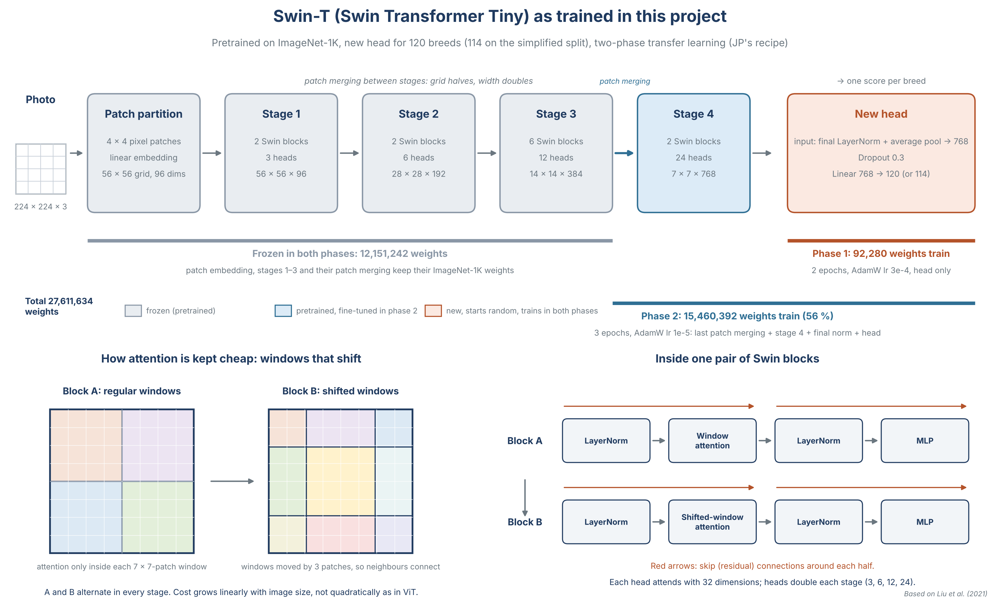

# Report sections: Swin-T (Sulaiman)

Draft text for the group report, written to drop into the brief's
recommended structure (sections 4 to 7, plus references). Every number comes
from `results/runs/unclean_transfer/` and `results/runs/simplified_transfer/`,
both trained and evaluated with JP's pipeline. Figure names refer to files in
those folders. The architecture diagram is `swin_architecture.png`.

Items marked **[GROUP]** depend on how the group words the shared sections.

---

## 4. Methodology: Swin Transformer (model family 3)

### 4.x.1 Why a transformer

The third model gives the comparison an architecture that does not rely on
convolution. A convolutional network sees an image through small filters
that slide over it, so each layer only looks at a local neighbourhood. A
transformer lets every part of the image compare itself with other parts
through self-attention, so relationships between distant regions, such as
ear shape against tail shape, can be learned directly.

The original Vision Transformer (ViT) (Dosovitskiy *et al.*, 2021) applies
attention between every pair of image patches, so its cost grows with the
square of the number of patches, and it needs very large datasets to train
well. The Swin Transformer (Liu *et al.*, 2021) was designed to fix both
problems, which makes it a better fit for a dataset of about 20,000
photographs.

### 4.x.2 How Swin works

1. **Patches.** The 224 × 224 image is cut into 4 × 4 pixel patches, giving
   a 56 × 56 grid. Each patch becomes a vector of 96 numbers.
2. **Window attention.** The grid is divided into non-overlapping windows of
   7 × 7 patches, and attention is computed only inside each window. The
   cost grows linearly with image size instead of quadratically.
3. **Shifted windows.** In every second block the window grid shifts by half
   a window, so patches on the edge of one window sit in the middle of the
   next. Information flows between neighbouring windows, and over several
   blocks the model builds a view of the whole image.
4. **Hierarchy.** Between stages, neighbouring 2 × 2 patches are merged,
   halving the grid (56, 28, 14, 7) and doubling the vector size (96, 192,
   384, 768). This gives the same coarse-to-fine pyramid a CNN has: early
   stages see fur texture and edges, late stages see whole heads and bodies.
5. **Classification.** The final 7 × 7 grid is averaged into one
   768-number summary of the photograph, which a linear layer maps to one
   score per class.

Swin-T ("Tiny") is the smallest standard variant: four stages with 2, 2, 6
and 2 blocks, 3, 6, 12 and 24 attention heads, and window size 7 (Liu
*et al.*, 2021).

*Figure: Swin-T as trained in this project. Top: the four stages and the new
head, with the parts frozen in both phases (grey), fine-tuned in phase 2
(blue) and newly added (red). Bottom left: regular and shifted windows.
Bottom right: the layers inside one pair of Swin blocks. Drawn for this
report, based on Liu et al. (2021).*

### 4.x.3 Transfer learning approach

The model was loaded from torchvision with the ImageNet-1K weights
`Swin_T_Weights.IMAGENET1K_V1` (PyTorch, 2026). The original 1,000-class head
was replaced by dropout (p = 0.3) and a new linear layer from 768 features
to the number of classes (120, or 114 for the simplified split). The new
layer starts from random weights.

Training followed the same two-phase recipe as JP's EfficientNetV2-S, so the
two pretrained models differ only in architecture:

- **Phase 1, feature extraction (2 epochs).** The whole backbone is frozen
  and only the new head trains (92,280 parameters, 0.3 % of the model). The
  head learns to map Swin's existing features to breeds without its large,
  random early gradients disturbing the pretrained weights.
- **Phase 2, fine-tuning (3 epochs).** The last patch-merging layer and
  stage 4 (`features[6:]`), the final normalisation layer and the head are
  unfrozen (15.46 M parameters, 56 % of the model) and trained with a
  learning rate 30 times smaller. Stages 1 to 3, which hold general features
  such as edges, fur texture and shapes, stay frozen. This mirrors JP
  unfreezing the top stages of EfficientNetV2-S.

Swin-T's stage 4 is large (its two blocks at 768 dimensions hold about half
of the model's parameters), so "the top stage" is a bigger share of the
model than it is for EfficientNetV2-S. **[GROUP]** mention this if the report
compares how much of each model was fine-tuned.

---

## 5. Experimental setup: Swin-T

### 5.x.1 Data

Two runs, on two of JP's split files (70/15/15, seed 42):

| Run | Split file | Classes | Train | Validation | Test |
|---|---|---|---|---|---|
| `unclean_transfer` | `split_manifest.json` | 120 | 14,355 | 3,025 | 3,200 |
| `simplified_transfer` | `split_manifest_simplified.json` | 114 | 14,257 | 2,989 | 3,164 |

The simplified split removes 170 photographs found by the duplicate check
(98 train, 36 validation, 36 test: duplicates, cross-split leaks and the same
photo filed under two breeds) and merges four look-alike groups:
Staffordshire Bullterrier + American Staffordshire Terrier, English Foxhound
+ Walker Hound, Toy + Miniature + Standard Poodle, and Miniature + Standard +
Giant Schnauzer.

The unclean model was also scored on the cleaned test set
(`split_manifest_clean.json`, 3,164 photographs, 120 classes), which isolates
the effect of the removed test photographs.

### 5.x.2 Settings

| Setting | Value |
|---|---|
| Model | torchvision `swin_t`, `Swin_T_Weights.IMAGENET1K_V1`, 27,611,634 parameters (27,607,020 with 114 classes) |
| Input | 224 × 224 resize, ImageNet mean and standard deviation |
| Augmentation (training only) | horizontal flip (p = 0.5), rotation up to 15°, colour jitter (brightness 0.15, contrast 0.15, saturation 0.1) |
| Phase 1 | 2 epochs, AdamW, learning rate 3e-4, cosine decay to 3e-5 |
| Phase 2 | 3 epochs, AdamW, learning rate 1e-5, cosine decay to 1e-7 |
| Weight decay | 0.01 (AdamW, Loshchilov & Hutter, 2019) |
| Loss | cross entropy with label smoothing 0.1 |
| Batch size | 32, no gradient accumulation |
| Model selection | epoch with the highest validation accuracy; no early stopping |
| Mixed precision | yes (PyTorch AMP) |
| Seed | 42 |

All of these are identical to JP's EfficientNetV2-S runs; the training and
evaluation code is the same, with only the model swapped.

### 5.x.3 Software and hardware

PyTorch 2.11.0 with CUDA 12.8 (Paszke *et al.*, 2019), torchvision 0.26.0,
scikit-learn for the metrics, Python 3.14, Windows 11, NVIDIA GeForce RTX
4060 Laptop GPU with 8 GB. Each run took about 9.1 minutes (about 110 s per
epoch).

---

## 6. Results: Swin-T

### 6.x.1 Training behaviour

| Epoch | Phase | Val accuracy, unclean | Val macro F1, unclean | Val accuracy, simplified | Val macro F1, simplified |
|---|---|---|---|---|---|
| 1 | head | 87.93 % | 0.8700 | 89.73 % | 0.8923 |
| 2 | head | 89.02 % | 0.8854 | 90.40 % | 0.9007 |
| 3 | fine-tune | 89.39 % | 0.8909 | 90.53 % | 0.9017 |
| 4 | fine-tune | 89.52 % | 0.8919 | 90.70 % | 0.9041 |
| 5 | fine-tune | **89.69 %** | **0.8938** | **90.93 %** | **0.9062** |

Validation accuracy was already about 88 % after one head-only epoch: the
frozen backbone already separates dog breeds well, and the new head only
has to read its features. Fine-tuning stage 4 added another 0.7 points
(unclean) and 0.5 points (simplified). The best epoch was the last one in
both runs, and validation loss was still falling (1.139 and 1.103), so five
epochs did not overfit (`training_curves.png`).

Training accuracy stayed below validation accuracy throughout (86.3 % vs
89.7 % at epoch 5, unclean). This is expected: training accuracy is measured
on augmented photographs, with dropout on and label smoothing in the loss,
while the weights are still changing.

### 6.x.2 Test results

| Run | Test photos | Top-1 accuracy (95 % interval) | Top-5 | Macro precision | Macro recall | Macro F1 |
|---|---|---|---|---|---|---|
| Unclean | 3,200 | **88.03 %** (86.86–89.11) | 99.31 % | 88.28 % | 87.69 % | **0.8747** |
| Unclean, clean test | 3,164 | 88.21 % (87.04–89.29) | 99.30 % | 88.46 % | 87.82 % | 0.8764 |
| Simplified | 3,164 | **89.92 %** (88.82–90.92) | 99.34 % | 90.17 % | 89.63 % | **0.8953** |

Intervals are Wilson 95 % intervals for a proportion. Test accuracy is about
1.7 points below validation accuracy in the unclean run and 1.0 point below
in the simplified run, which is normal sampling difference between two sets
of about 3,000 photographs.

### 6.x.3 Per-breed results and the confusion matrix

In the unclean run, 10 of 120 breeds reached F1 = 1.0 (among them Pug,
Rottweiler, Saint Bernard, Keeshond, Chow and African Hunting Dog), and 9
fell below 0.7. The weakest breeds and where their photographs went:

| Breed | F1 | Recall | Most common mistake |
|---|---|---|---|
| Eskimo Dog | 0.276 | 0.17 | Siberian Husky (16 of 23) |
| Collie | 0.303 | 0.21 | Shetland Sheepdog (10), Border Collie (9) |
| Lhasa | 0.480 | 0.41 | Shih-Tzu (9) |
| English Foxhound | 0.636 | 0.56 | Walker Hound (7) |
| American Staffordshire Terrier | 0.640 | 0.62 | (Staffordshire Bullterrier is called AmStaff 7 times) |
| Miniature Poodle | 0.667 | 0.54 | Toy Poodle (6) |

The confusion matrix (`eval_test/confusion_matrix.png`) has a strong
diagonal; its off-diagonal mass sits in small clusters of related breeds:
spitz types, collie types, small long-haired Tibetan breeds, the poodles,
the bull terriers and the foxhounds. Of the 383 test errors, the twelve most
frequent breed pairs account for 89.

In the simplified run, 11 of 114 classes reached F1 = 1.0 and only 4 fell
below 0.7: Eskimo Dog (0.438), Collie (0.471), Lhasa (0.566) and Siberian
Husky (0.687). The merged classes all scored well: Poodle 0.958, Schnauzer
0.944, Staffordshire Terrier 0.917 and Foxhound 0.870.

---

## 7. Discussion and error analysis: Swin-T

### 7.x.1 The errors are look-alike breeds

The remaining mistakes are concentrated in breeds that people also confuse.
Eskimo Dog and Siberian Husky share coat colour, mask and build; Collie,
Shetland Sheepdog and Border Collie are close relatives; Lhasa and Shih-Tzu
are small long-haired Tibetan breeds that look alike in photographs. In
several cases the dataset itself is part of the problem: JP's duplicate
check found the same photograph filed under two different breeds 50 times,
mostly between look-alike breeds (6 times Collie and Border Collie, 6 times
English Foxhound and Walker Hound, 2 times Eskimo Dog and Siberian Husky). Photographs are also squashed to 224 × 224
rather than cropped, which distorts body proportions, one of the cues that
separate these breeds.

### 7.x.2 What cleaning and merging changed

Scoring the same unclean model on the cleaned test set changes accuracy by
only +0.18 points (88.03 % to 88.21 %). The 36 removed test photographs did
not inflate the score in any measurable way.

Merging look-alike breeds has a larger effect. On the same 3,164 test
photographs, the 114-class model scores 89.92 % against 88.21 % for the
120-class model, and macro F1 rises from 0.876 to 0.895. The merged classes
explain most of this: in the unclean run their constituent breeds scored
F1 between 0.64 and 0.98 (Miniature Poodle 0.667, English Foxhound 0.636,
American Staffordshire Terrier 0.640), while the merged classes score 0.87
to 0.96. This gain comes partly from cleaner training labels and partly
from a task that is easier by construction, since the merged breeds can no
longer be confused with each other. The two effects cannot be separated
with these runs, so the simplified score should be reported as a different
task, not as an improved model.

### 7.x.3 ImageNet overlap and memorisation

Stanford Dogs was built from ImageNet images (Khosla *et al.*, 2011), and
Swin-T was pretrained on ImageNet-1K (Deng *et al.*, 2009). The backbone has
therefore very likely seen many of the test photographs, with their breed
labels, before fine-tuning. Some of the gap between the pretrained models
and the baseline CNN reflects that prior exposure, not only better general
visual knowledge. This applies equally to EfficientNetV2-S. Lindani's CNN,
trained from scratch, is the only score in the project free of this effect.

### 7.x.4 Swin-T against EfficientNetV2-S and the baseline

| Model | Pretrained | Parameters | Split | Top-1 (95 % interval) | Top-5 | Macro F1 | Training |
|---|---|---|---|---|---|---|---|
| Baseline CNN (Lindani) | no | 4.58 M | unclean | 53.84 % | 84.78 % | 0.5320 | 64 min, Tesla T4 |
| EfficientNetV2-S (JP) | ImageNet-1K | 20.3 M | unclean | 83.12 % (81.78–84.38) | 97.75 % | 0.8254 | 14.7 min, RTX 4050 |
| **Swin-T (Sulaiman)** | ImageNet-1K | 27.6 M | unclean | **88.03 %** (86.86–89.11) | 99.31 % | **0.8747** | 9.1 min, RTX 4060 |
| EfficientNetV2-S (JP) | ImageNet-1K | 20.3 M | simplified | 84.54 % (83.24–85.76) | 97.79 % | 0.8402 | 16.2 min, RTX 4050 |
| **Swin-T (Sulaiman)** | ImageNet-1K | 27.6 M | simplified | **89.92 %** (88.82–90.92) | 99.34 % | **0.8953** | 9.1 min, RTX 4060 |

- **Attention against convolution.** EfficientNetV2-S and Swin-T were
  trained by the same code, with the same recipe, on the same split files.
  Swin-T is ahead by 4.9 points of accuracy and 0.049 macro F1 on the
  unclean split and by 5.4 points and 0.055 on the simplified split. The
  95 % intervals do not overlap, so the difference is not noise from the
  test sample. Swin-T is about a third larger (27.6 M against 20.3 M
  parameters), and its fine-tuning phase updated a larger share of the
  network, so part of the gap may come from capacity rather than attention
  alone. Training times are not directly comparable because the GPUs
  differ.
- **Transfer learning.** Both pretrained models are more than 29 points
  ahead of the from-scratch CNN, with the ImageNet-overlap caveat above.
- **Same breeds are hard for both.** Eskimo Dog and Collie are the two
  weakest classes for EfficientNetV2-S as well (F1 0.069 and 0.313 on the
  unclean split), so the hardest errors come from the data, not from one
  architecture.
- **Recommendation.** On test macro F1, Swin-T is the strongest of the three
  models on both split files.

### 7.x.5 The earlier Swin-T run

An earlier run (kept in `previous_run_lindani_pipeline/`) fine-tuned the
whole network for 15 epochs at learning rate 1e-4 with Lindani's pipeline and
reached 85.38 % test accuracy (macro F1 0.849) on the original split. The
two-phase recipe reached 88.03 % (0.875) in a third of the epochs and half
the time. Two differences plausibly explain it: keeping stages 1 to 3
frozen protects the pretrained features from being overwritten, and label
smoothing discourages over-confident predictions. Given the ImageNet overlap,
a backbone that stays closer to its pretrained weights may also retain more
memory of these exact photographs, so this comparison should not be read as
proof that freezing generalises better. The two runs also differ in their
code, so this is only a reference point; the group comparison uses the
two-phase runs.

### 7.x.6 Limitations

- One training run per split with one seed; no estimate of run-to-run
  variation.
- Hyperparameters follow JP's recipe and were not tuned for Swin-T, to keep
  the comparison fair and the test set untouched.
- Photographs are resized to 224 × 224 without cropping, which distorts
  proportions. The torchvision weights were trained with a resize to 232
  (bicubic) and a centre crop to 224 (PyTorch, 2026), so the input differs
  slightly from pretraining. This applies equally to EfficientNetV2-S.
- The simplified split changes the task, so its scores are not directly
  comparable to the 120-class scores.
- ImageNet overlap and label noise, as above.

---

## References (NWU Harvard)

Deng, J., Dong, W., Socher, R., Li, L.-J., Li, K. & Fei-Fei, L. 2009.
ImageNet: a large-scale hierarchical image database. Paper delivered at the
IEEE Conference on Computer Vision and Pattern Recognition (CVPR), Miami, FL.
https://ieeexplore.ieee.org/document/5206848 Date of access: 18 Oct. 2026.

Dosovitskiy, A., Beyer, L., Kolesnikov, A., Weissenborn, D., Zhai, X.,
Unterthiner, T., ... Houlsby, N. 2021. An image is worth 16x16 words:
transformers for image recognition at scale. Paper delivered at the
International Conference on Learning Representations (ICLR 2021).
https://arxiv.org/abs/2010.11929 Date of access: 18 Oct. 2026.

Khosla, A., Jayadevaprakash, N., Yao, B. & Fei-Fei, L. 2011. Novel dataset
for fine-grained image categorization. Paper delivered at the First Workshop
on Fine-Grained Visual Categorization, IEEE Conference on Computer Vision and
Pattern Recognition, Colorado Springs, CO.
https://people.csail.mit.edu/khosla/papers/fgvc2011.pdf Date of access: 18
Oct. 2026.

Liu, Z., Lin, Y., Cao, Y., Hu, H., Wei, Y., Zhang, Z., ... Guo, B. 2021.
Swin Transformer: hierarchical vision transformer using shifted windows.
Paper delivered at the IEEE/CVF International Conference on Computer Vision
(ICCV 2021).
https://openaccess.thecvf.com/content/ICCV2021/papers/Liu_Swin_Transformer_Hierarchical_Vision_Transformer_Using_Shifted_Windows_ICCV_2021_paper.pdf
Date of access: 18 Oct. 2026.

Loshchilov, I. & Hutter, F. 2019. Decoupled weight decay regularization.
Paper delivered at the International Conference on Learning Representations
(ICLR 2019), New Orleans, LA. https://arxiv.org/abs/1711.05101 Date of
access: 18 Oct. 2026.

Paszke, A., Gross, S., Massa, F., Lerer, A., Bradbury, J., Chanan, G., ...
Chintala, S. 2019. PyTorch: an imperative style, high-performance deep
learning library. Paper delivered at the 33rd Conference on Neural
Information Processing Systems (NeurIPS 2019), Vancouver.
https://proceedings.neurips.cc/paper/2019/hash/bdbca288fee7f92f2bfa9f7012727740-Abstract.html
Date of access: 18 Oct. 2026.

PyTorch. 2026. swin_t: TorchVision documentation.
https://docs.pytorch.org/vision/stable/models/generated/torchvision.models.swin_t.html
Date of access: 18 Oct. 2026.

---

## Oral presentation: Swin-T slide and likely questions

**One slide:** the Swin diagram, the headline numbers (88.0 % test accuracy,
0.875 macro F1, 99.3 % top-5 on the original split; 89.9 % / 0.895 on the
simplified split), and one sentence: "Same pipeline as EfficientNetV2-S,
about 5 points better; the remaining errors are look-alike breeds."

**Questions to expect:**

- *What does "shifted window" mean?* Attention is only computed inside 7 × 7
  patch windows to keep it cheap; every second block the windows move by half
  a window so neighbouring windows share information.
- *Why freeze the backbone first?* The new head starts random, so its early
  gradients are large and noisy. Training it alone first stops that noise
  from damaging the pretrained weights.
- *Why only unfreeze stage 4?* Early stages hold general features (edges,
  texture) that transfer as they are; the last stage holds the most
  task-specific features, so that is where adapting to dog breeds helps.
- *Why is validation accuracy higher than training accuracy?* Training
  accuracy is measured with augmentation, dropout and label smoothing on.
- *Only five epochs. Is that enough?* Validation accuracy was 88 % after one
  epoch and still creeping up at epoch 5 with validation loss falling, so
  more epochs might add a little, but the recipe was fixed to match JP's
  runs.
- *Is the comparison with EfficientNetV2-S fair?* Same code, split files,
  recipe and metrics. Swin-T is a bit larger and fine-tunes a larger share
  of its weights, which should be mentioned.
- *Why did the simplified split score higher?* Mostly because the merged
  breeds can no longer be confused; cleaning the test set alone changed
  accuracy by only 0.18 points.
- *Why might the scores be optimistic?* Stanford Dogs comes from ImageNet,
  which the backbone was pretrained on.
